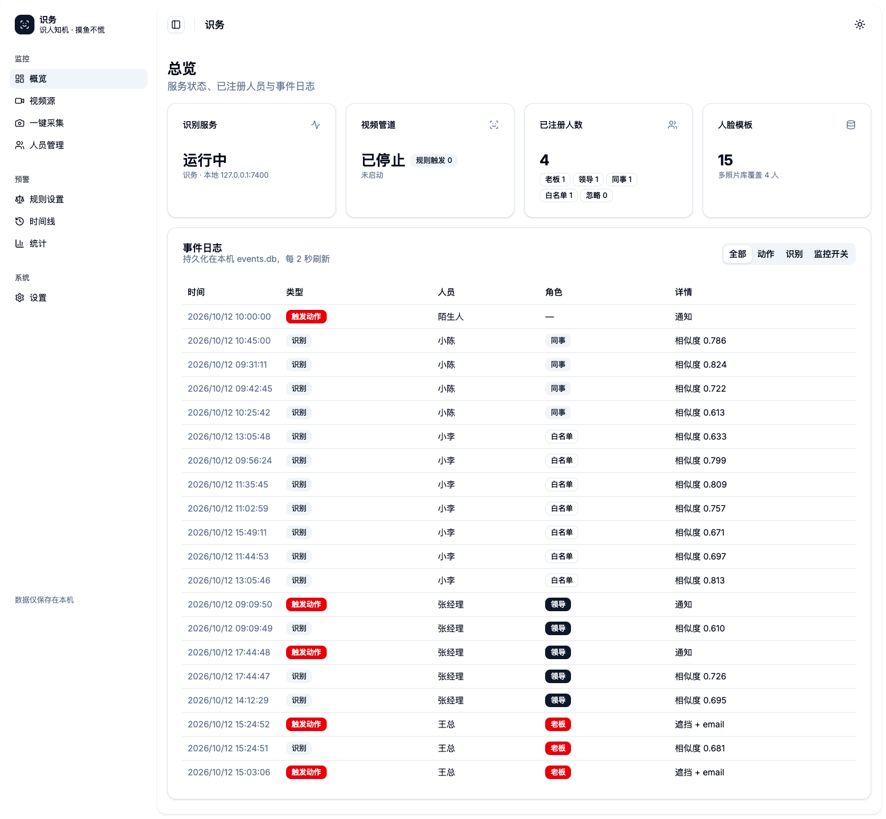
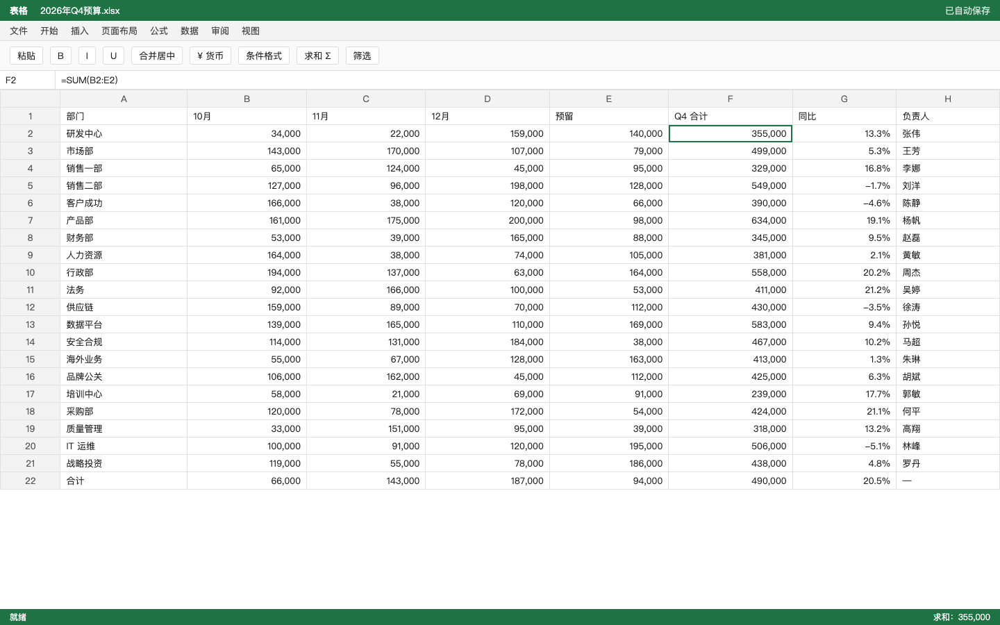
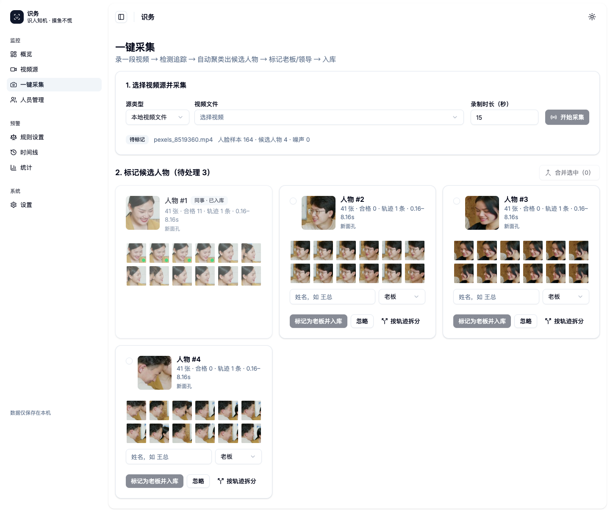
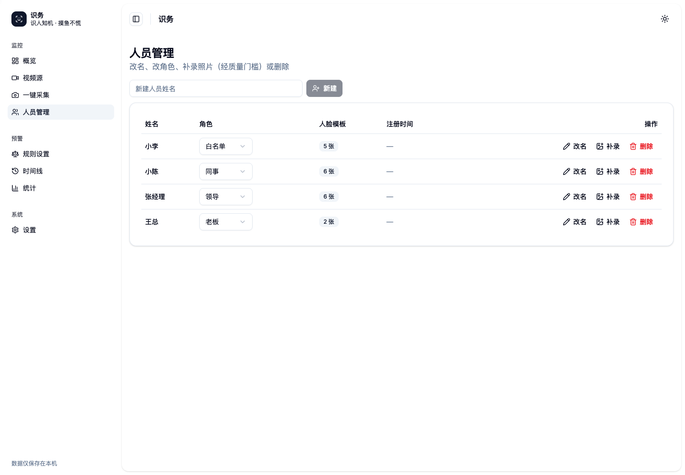
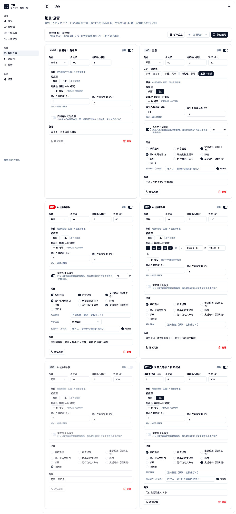
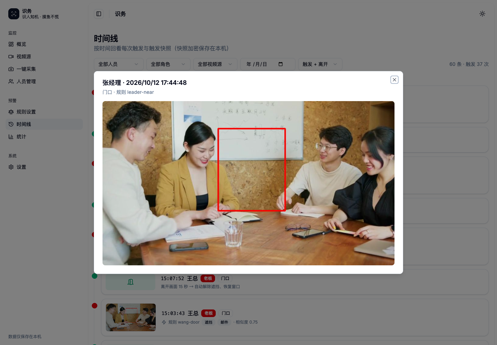
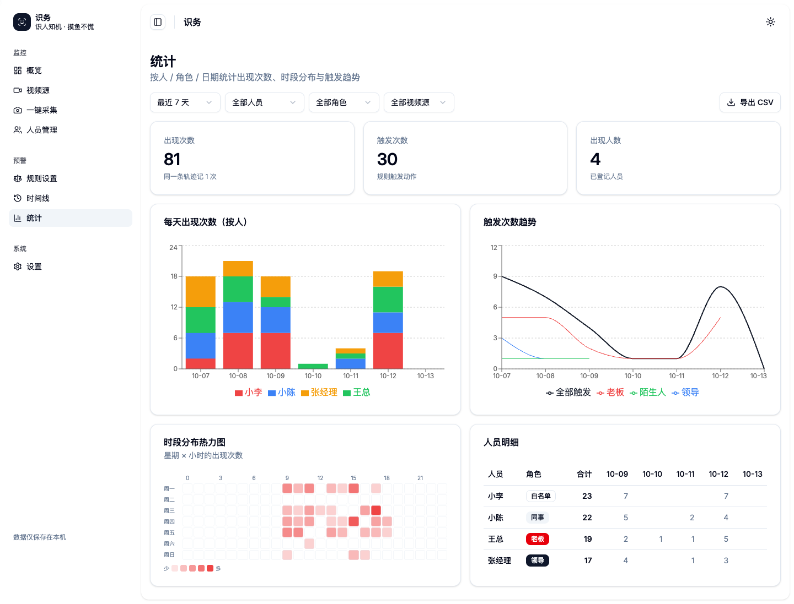

# 识务 · ShiWu

**认出谁来了，自动提醒或遮挡屏幕。**

识务是一款本地运行的人脸识别预警工具：通过摄像头识别已登记的人员，按你设置的规则执行桌面动作。例如，老板出现在镜头里时，弹出提醒、播放声音，并用一张表格遮住当前屏幕；白名单人员经过时，不触发提醒。

人脸识别在本机完成，无需云端识别服务。桌面端托盘常驻，人员、规则和事件都在管理界面中配置。

[快速开始](#快速开始) · [功能与界面](#功能与界面) · [数据与隐私](#数据与隐私) · [开发与打包](#开发与打包)



## 功能与界面

### 从登记人员到自动响应

```text
采集人脸 → 标记姓名与角色 → 配置触发规则 → 开始监控 → 执行动作、记录事件
```

| 能力 | 可以做什么 |
| --- | --- |
| 人员登记 | 从摄像头或视频采集人脸，自动聚类候选人物，确认后登记姓名与角色；支持同一人的多张模板 |
| 多路监控 | 使用本机摄像头、网络视频源或视频文件；每路单独命名，规则可限定视频源；实时画面仅通过手机扫码预览 |
| 条件规则 | 按人员、角色或陌生人触发，设置时间段、接近程度、连续确认与冷却时间；支持白名单和离开恢复 |
| 自动动作 | 组合通知、声音、全屏遮挡、最小化窗口、切换程序、静音、锁屏、自定义命令或邮件，也可只记录 |
| 事件回看 | 按人员、角色、时间与视频源筛选事件，查看触发快照和统计 |

识别采用人脸检测、特征匹配与轨迹多帧投票，减少单帧波动。识别效果受光线、角度、距离和登记样本影响，不保证每次都能认出；评测条件与结果见[架构与实测](docs/architecture.md#五实测数据)。

### 全屏遮挡

触发后，屏幕显示一张模拟表格，**不是启动或编辑真实 Excel 文件**。



解除遮挡：Windows / Linux 按 **Ctrl + Alt + B**，macOS 按 **⌘ + ⌥ + B**。也可在规则中启用离开后自动恢复。

<details>
<summary><strong>展开更多界面：采集、人员、规则、时间线与统计</strong></summary>

### 一键采集

自动整理候选人物，人工确认身份后入库。



### 人员管理

维护姓名、角色和人脸模板。内置角色包括老板、领导、同事、白名单与忽略。



### 规则设置

指定谁来、何时触发、执行哪些动作，以及多久允许再次触发。



### 时间线

回看识别与触发事件，查看当时的快照。



### 统计

查看识别与规则触发的分布。



</details>

> 截图为演示界面：人物来自素材视频中的演员，历史事件由脚本合成，不代表真实人员的活动记录。

## 快速开始

以下为**源码运行**方式。项目提供 macOS、Windows 和 Linux 打包配置，但摄像头权限与系统动作存在平台差异，不能将打包支持等同于完整真机验证。

### 环境准备

需要 Git、[uv](https://docs.astral.sh/uv/)、Node.js **22.12+** 和 [pnpm](https://pnpm.io/installation)。Python 要求 **3.11+**，下面使用 3.13；ONNX 模型位于仓库的 `src/shiwu/assets/models/`，无需另行下载模型。

**1. 获取源码**

```bash
git clone https://github.com/gugugaga008/ShiWu.git
cd ShiWu
```

**2. 安装 Python 服务依赖**（macOS / Linux）

```bash
uv venv .venv --python 3.13
uv pip install -e . --python .venv/bin/python
```

Windows PowerShell 使用：

```powershell
uv venv .venv --python 3.13
uv pip install -e . --python .venv\Scripts\python.exe
```

**3. 构建管理界面，安装桌面端依赖**

```bash
pnpm --dir apps/web install --frozen-lockfile
pnpm --dir apps/web build
pnpm --dir apps/desktop install --frozen-lockfile
```

**4. 启动桌面端**

```bash
pnpm --dir apps/desktop start
```

桌面端会自动启动 Python 服务、生成会话 Token 并打开管理界面，**不需要另开一个后端进程**。默认使用本机端口 `7400`，占用时会尝试后续端口。

> **macOS 摄像头没有弹出授权框？** 从某些 IDE 或桌面工具的内置终端启动，会继承不具备摄像头权限的责任进程。可在仓库根目录改用下面的方式启动；详细排查见[摄像头文档](docs/camera.md)。
>
> ```bash
> open -n apps/desktop/node_modules/electron/dist/Electron.app --args "$PWD/apps/desktop"
> ```

### 第一次使用

1. **检查「规则设置」**：内置老板规则包含遮挡与最小化动作。初次试用先改成「仅记录」，避免测试时影响当前窗口。
2. **打开「一键采集」**：选择视频源，采集一段人脸视频，确认候选人物并填写姓名、角色。
3. **打开「视频源」**：添加摄像头、网络流或视频文件并启动；点击该路的「手机预览」，使用同一 Wi-Fi 的手机扫码，在手机浏览器查看实时画面。电脑只显示状态、识别结果与二维码，不显示实时画面。没有摄像头也可先用视频文件测试。
4. **启用需要的动作**：确认身份匹配正确后，再打开通知或遮挡等动作；在「时间线」查看触发记录。

### 手机扫码预览

1. 将手机与电脑接入同一可信 Wi-Fi，启动需要查看的视频源。
2. 点击该路「手机预览」，扫描弹窗二维码，在手机浏览器打开。
3. 查看结束后关闭电脑上的二维码弹窗，立即撤销手机访问。

链接最长有效 **10 分钟**，过期后重新生成；停止或替换视频源也会使链接失效。多网卡电脑可在弹窗切换地址；连接失败时检查防火墙及路由器的设备隔离。无需云服务，不支持跨网络远程预览。实时预览使用管道已有的带框 JPEG 帧，不包含声音。

二维码是临时的单路只读访问凭据，不要分享。临时预览通过局域网 HTTP 传输，未使用 TLS，仅在可信网络启用。采集的人脸缩略图和历史事件快照仍在管理界面展示，本功能仅隐藏实时视频画面。

### 平台注意事项

- **macOS**：摄像头需要授权；控制其他程序或窗口的动作可能需要「自动化」「辅助功能」权限。
- **Linux**：最小化窗口和切换程序仅支持 X11，需 `xdotool` 或 `wmctrl`；Wayland 下这些动作不可用。
- **Windows**：没有 `nircmd` 时，静音动作使用切换式媒体键，已静音时再次执行会取消静音。

## 数据与隐私

**识别与数据存储默认在本机；这不等于所有功能都不会联网。**

- 不依赖云端人脸识别 API，人员库、规则、事件与快照存储在本机。
- 启用邮件动作后，会通过你配置的 SMTP 服务发送事件信息，并可能附带快照；网络视频源也会访问对应地址。
- 触发快照默认采用 AES-GCM 加密。机器密钥使用平台保护机制；系统密钥环不可用时，macOS / Linux 会回退到本地密钥文件。加密模块加载失败时快照会以明文保存，应检查「设置」中的快照加密状态。
- 本地管理服务默认监听 `127.0.0.1`，业务接口使用会话 Token 鉴权。点击「手机预览」时另启临时局域网端口，仅提供绑定单路视频源的只读画面；无有效预览会话时关闭端口，不向手机提供管理接口或主会话 Token。不要将服务直接暴露到公网，也不要分享 Token 或二维码。
- 只登记和采集已获授权的人员；本工具用于辅助提醒，不应用作门禁、身份认证或其他高风险决策依据。自定义命令以当前用户权限执行，仅使用可信命令。

源码运行的数据位于 `var/data/` 与 `var/gallery/`；安装包运行时使用用户数据目录。可分别通过 `SHIWU_DATA_DIR`、`SHIWU_GALLERY_DIR` 覆盖，详细路径约定见[架构文档](docs/architecture.md#三路径约定)。

## 开发与打包

技术栈：**Python / FastAPI / ONNX Runtime / SQLite + React / Vite + Electron**。

```text
apps/
  web/              React 管理界面
  desktop/          Electron 桌面端、摄像头采集与系统动作
src/shiwu/          Python 识别管道、规则引擎与 API
scripts/            演示数据、评测与截图工具
tests/              后端测试与评测标注
packaging/          PyInstaller 配置
```

以下命令均从仓库根目录执行；Python 命令以 macOS / Linux 为例，Windows 将 `.venv/bin/python` 换为 `.venv\Scripts\python.exe`。

<details>
<summary><strong>独立启动后端 / 使用浏览器管理</strong></summary>

```bash
SHIWU_API_TOKEN='<LOCAL_API_TOKEN>' .venv/bin/python -m shiwu --port 7400
```

将 `<LOCAL_API_TOKEN>` 替换为自行生成的随机值。**CLI 启动必须设置 `SHIWU_API_TOKEN`**，未设置时会退出。

构建过前端后，可打开 `http://127.0.0.1:7400/ui/`；业务 API 请求使用 `X-Shiwu-Token` 请求头。独立后端可运行识别、记录与邮件功能，遮挡、窗口控制等桌面动作需要 Electron。

</details>

<details>
<summary><strong>测试与前端构建</strong></summary>

```bash
uv pip install -e '.[dev]' --python .venv/bin/python
.venv/bin/python -m pytest -q tests
pnpm --dir apps/web build
node --test apps/desktop/test/actions.test.js apps/desktop/test/windows.test.js
```

部分后端测试依赖视频素材，缺少时会跳过。需要运行这些测试时，先执行 `bash scripts/fetch_assets.sh`；来源和用途见[素材说明](assets/README.md)。

</details>

<details>
<summary><strong>生成演示数据</strong></summary>

演示脚本会写入人员、规则与历史事件，**不要对日常使用的数据目录执行**。下面使用独立的临时目录（macOS / Linux）。

先下载素材，在第一个终端启动服务：

```bash
bash scripts/fetch_assets.sh
export SHIWU_DATA_DIR="$(mktemp -d)/data"
export SHIWU_GALLERY_DIR="${SHIWU_DATA_DIR%/data}/gallery"
export SHIWU_API_TOKEN='<LOCAL_API_TOKEN>'
printf '数据目录：%s\n人脸库目录：%s\n' "$SHIWU_DATA_DIR" "$SHIWU_GALLERY_DIR"
.venv/bin/python -m shiwu --port 7400
```

在第二个终端，将路径和 Token 替换为第一个终端的相同值：

```bash
SHIWU_DATA_DIR='<DEMO_DATA_DIR>' SHIWU_GALLERY_DIR='<DEMO_GALLERY_DIR>' \
  .venv/bin/python scripts/seed_demo.py \
  --url http://127.0.0.1:7400 --token '<LOCAL_API_TOKEN>' --history 7
```

访问 `http://127.0.0.1:7400/ui/` 查看演示。服务与脚本必须使用相同的数据目录和机器密钥环境，否则历史事件与快照无法正确对应。

</details>

<details>
<summary><strong>构建安装包</strong></summary>

先构建前端并打包 Python 服务：

```bash
pnpm --dir apps/web build
.venv/bin/python -m PyInstaller packaging/shiwu.spec --noconfirm \
  --distpath dist --workpath build/pyi
```

再按目标平台选择**一个**命令：

```bash
pnpm --dir apps/desktop dist:mac
pnpm --dir apps/desktop dist:win
pnpm --dir apps/desktop dist:linux
```

Python 产物位于 `dist/server/`，桌面安装包位于 `apps/desktop/release/`。Python 服务需匹配目标系统和架构；上述命令不代表可以跨平台打包。macOS 摄像头 entitlement 与其他打包细节见[打包说明](docs/architecture.md#六打包)。

</details>

## 文档与许可

| 文档 | 内容 |
| --- | --- |
| [架构与实测](docs/architecture.md) | 模块分层、API、数据路径、评测结果与已知限制 |
| [摄像头采集](docs/camera.md) | macOS 权限、采集窗口模式与零帧排查 |
| [素材说明](assets/README.md) | 测试视频来源与用途 |
| [变更记录](docs/process.md) | 项目变更与实际验证结果 |

项目采用 **AGPL-3.0-only**，详见 [LICENSE](LICENSE)。第三方组件的归属说明与许可原件见 [NOTICE](NOTICE) 和 [licenses/](licenses/)。
